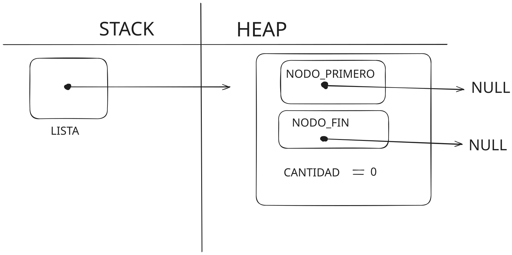
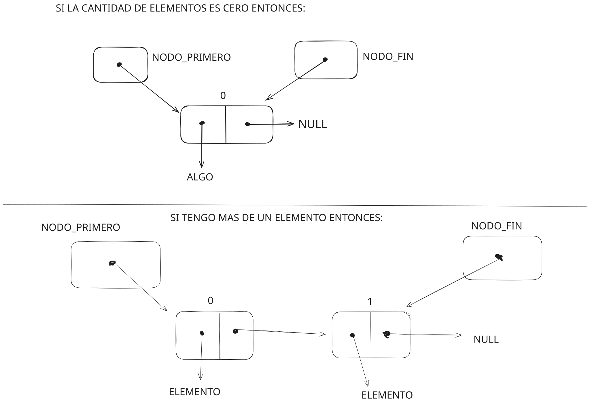
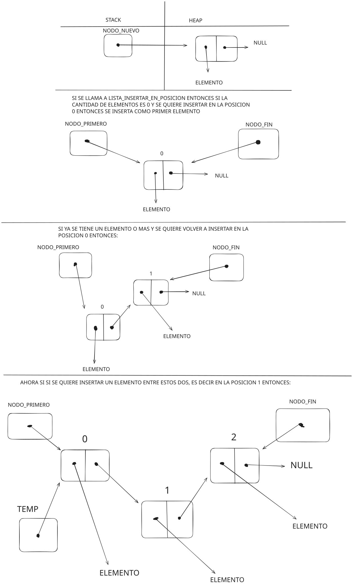
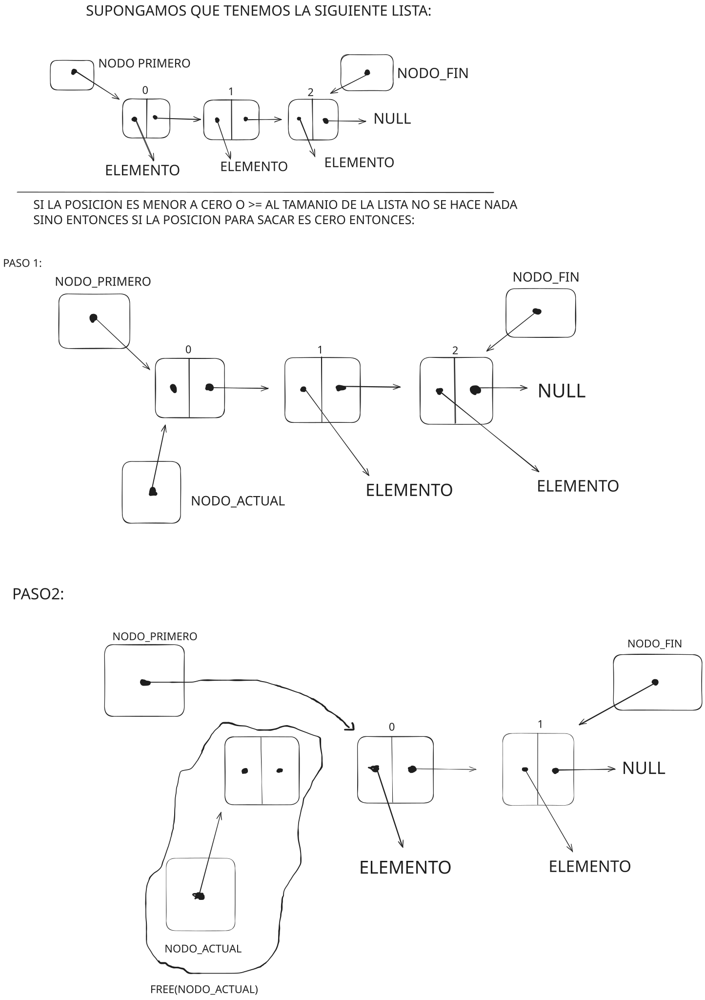
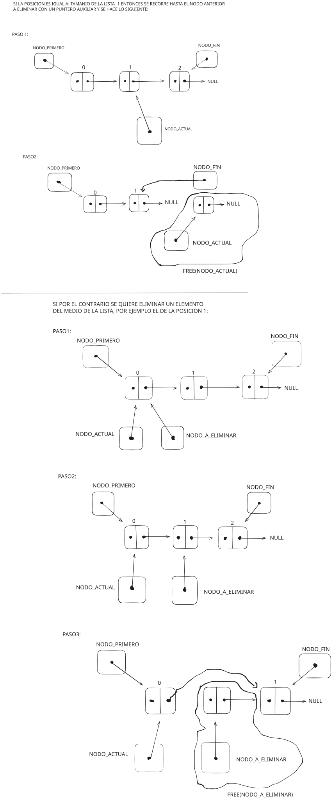
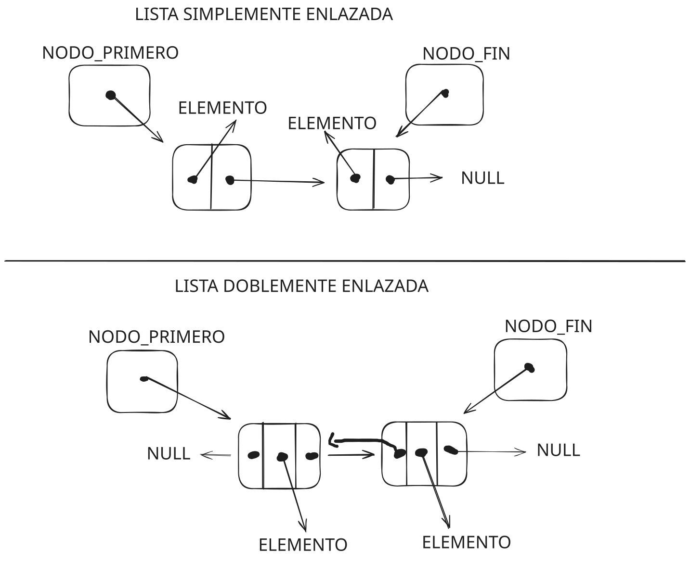
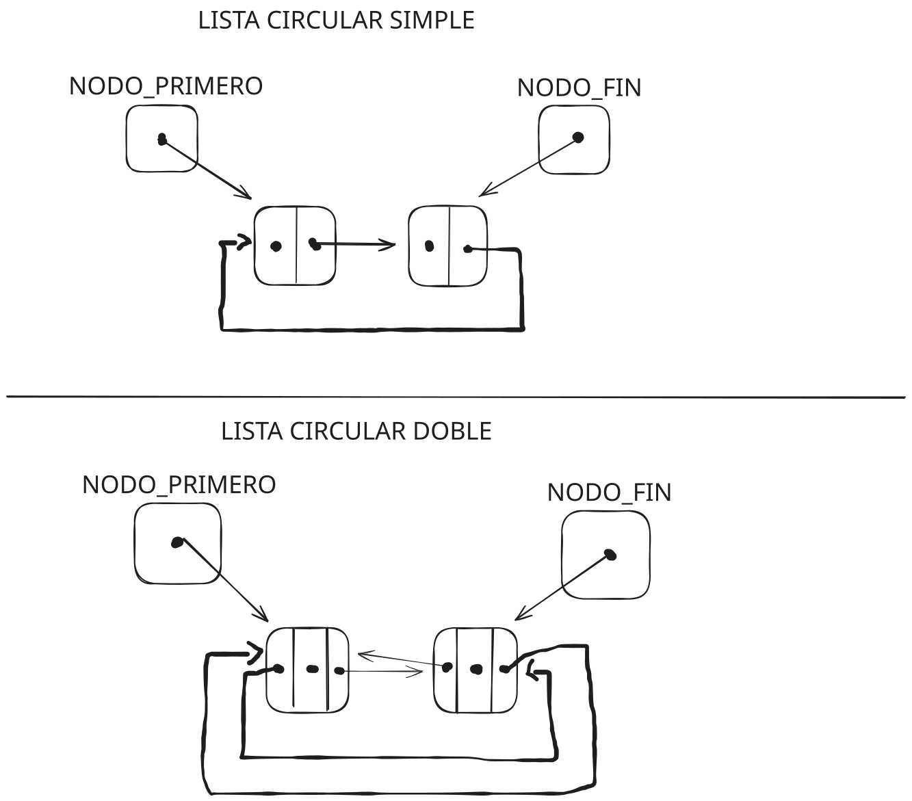
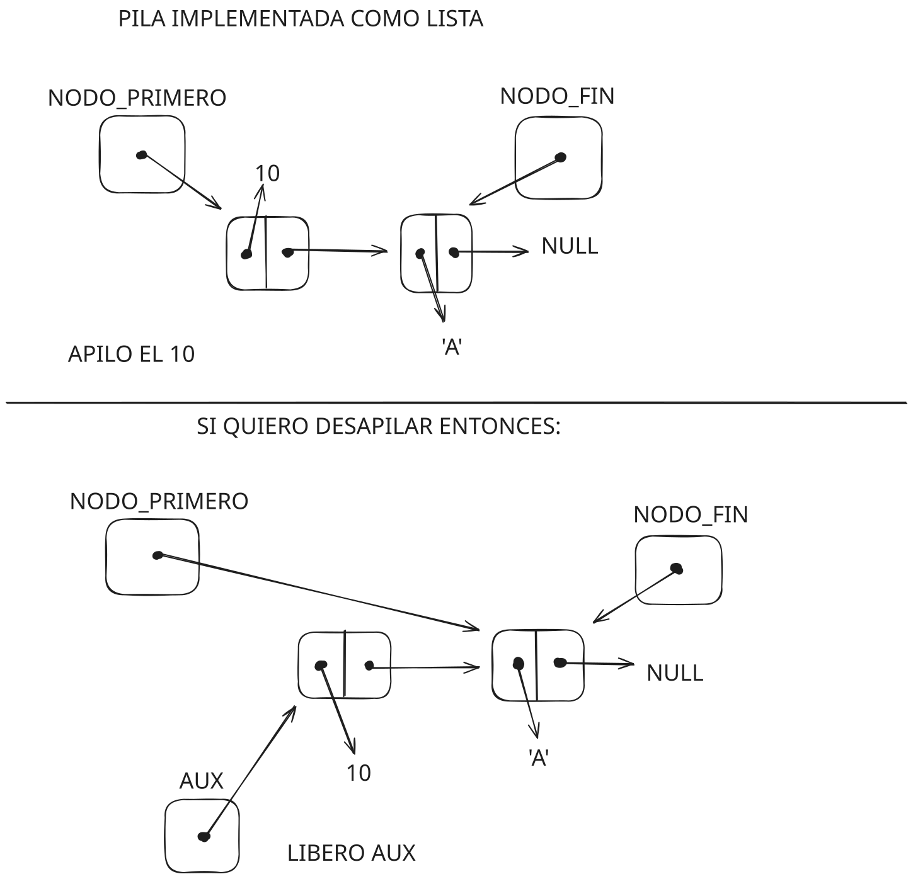
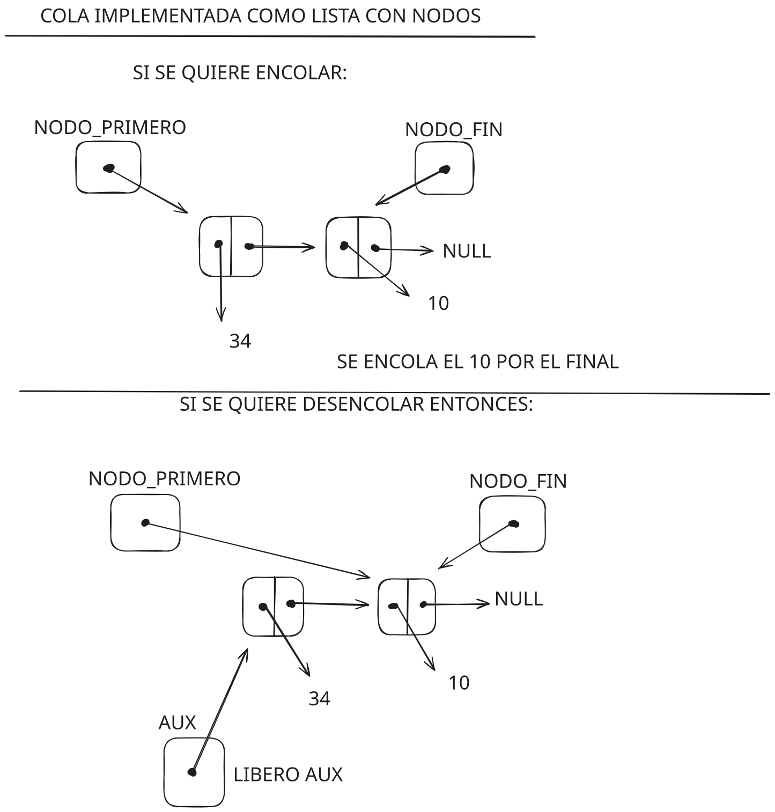

<div align="right">

</div>

# TDA LISTA/PILA/COLA

## Repositorio de (Dylan Tiziano Robledo) - (112439) - (trobledo2017@gmail.com)

- Para compilar:

```bash
gcc pruebas_alumno.c src/lista.c src/pila.c src/cola.c -Wall -Wextra -Werror -std=c99 -g -o pruebas_alumno
```

- Para ejecutar:

```bash
./pruebas_alumno
```

- Para ejecutar con valgrind:
```bash
valgrind --leak-check=full ./pruebas_alumno
```
---
##  Funcionamiento de Lista

El programa funciona reservando memoria dinamica en el heap para crear la lista enlazada la cual va a tener en mi caso un puntero a la cabecera de la lista y otra al ultimo nodo de la lista. En mi estructura de lista_t uso tres variables, nodo_primero el cual lo uso como cabecera, nodo_fin el cual me favorece al momento de insertar un elemento al final de la lista ya que no necesito recorrer toda la lista hasta llegar al final e insertar y una ultima variable llamada cantidad que me sirve para saber cuantos elementos tengo actualmente en la lista. Luego con la lista se pueden efectuar distintas operaciones como sacar un elemento, insertar un elemento, iterar sobre la lista, etc. Dependiendo de lo que se quiera hacer con la lista, la operacion se efectuara con exito o no se hara nada en caso de que la operacion sea invalida. Obviamente que cada vez que se quiera insertar un elemento reservo memoria para una estructura de tipo nodo_t el cual tiene dos variables. Una es la variable elementos que es un puntero void porque no se sabe lo que hay almacenado en cada nodo de la lista, puede ser cualquier cosa y la otra variable es un puntero a otra estructura de tipo nodo_t ya que la idea es que cada nodo tenga un puntero al siguiente nodo.

<div align="center">

</div>

### Breve explicacion de como funciona lista_insertar:
Esta funcion lo que hace es antes que nada verificar si la lista es NULL donde si lo es no hay nada que hacer. Caso contrario, si la cantidad de elementos en la lista es de cero o no hay ningun elemento mejor dicho lo que se hace es reservar memoria con calloc para un nodo donde el puntero de elementos va a apuntar al elemento pasado por parametro y el puntero siguiente va a apuntar a NULL. Luego hago que el puntero nodo_primero y nodo_fin apunten a este nodo. Ahora si ya habia un nodo o mas de uno lo que hago es acceder al puntero siguiente del ultimo nodo con el puntero nodo_fin y hacerlo apuntar al nuevo nodo reservado para luego reapuntar nodo_fin al nuevo nodo reservado.


<div align="center">

</div>

### Como funciona lista_insertar_en_posicion:
Esta funcion tiene una similitud con lista_insertar y es que si no se quiso insertar un elemento con lista_insertar cuando la cantidad de elementos de la lista es cero y se pasa la posicion cero por parametro entonces se llama a lista_insertar o si la posicion recibida es igual al tamanio de la lista entonces tambien se llama a lista_insertar para insertar el elemento al final de la lista. Ahora la diferencia de esta funcion con la anterior es que se puede insertar en cualquier posicion de la lista siempre y cuando sea valida. Por ejemplo: si se tienen las posiciones 0 y 1 y se quiere insertar en la posicion 1 entonces el elemento u nodo que tenia posicion 1 ahora tendra posicion 2.


<div align="center">

</div>

### Como funciona lista_sacar_de_posicion:
En esta funcion primero que nada se chequea si la lista es NULL o si la posicion recibida por parametro es invalida ya sea por ser menor a cero o >= al tamanio de la lista. Luego se evaluan unos casos particulares en base a la posicion recibida y ademas creo un puntero auxiliar apuntando al primer nodo al que apunta la cabecera. Si la posicion es cero entonces lo que hago es con el puntero nodo_primero hacerlo apuntar al siguiente nodo y despues con el puntero nodo_actual libero el nodo al que apuntaba antes nodo_primero. Ahora si la posicion es en cambio igual al tamanio de la lista menos uno, es decir la ultima posicion del elemento de la lista entonces lo que hago es con el puntero nodo_actual iterar sobre cada nodo hasta llegar al anteultimo nodo y cuando estoy en este nodo hago que nodo_fin apunte para este nodo el cual es el que estoy apuntando con el puntero auxiliar y despues con el auxiliar accedo al siguiente nodo que era el ultimo y con este mismo puntero libero el ultimo nodo. Por ultimo una opcion mas complicada es quitar un elemento de la lista recibiendo por parametro una posicion esta en la mitad de la lista. En este caso que fue en el que tuve un poco mas de dificultad lo que hice fue recorrer nodo por nodo hasta llegar no al nodo que quiero eliminar sino al anteultimo a eliminar con el puntero auxiliar nodo_actual y cuando llego hasta ahi creo otro puntero auxiliar llamado nodo_a_eliminar que apunte al nodo siguiente al que apunta nodo_actual que es el nodo que realmente quiero eliminar. Luego con el puntero nodo_actual hago que el nodo que esta siendo apuntado por este apunte al nodo siguiente al que apunta nodo_a_eliminar y termino liberando el nodo que queria eliminar con el nodo_a_eliminar. 

<div align="center">

</div>

<div align="center">

</div>

## Complejidades de las funciones de Lista:

### Complejidad de lista_crear:
En esta funcion lo que hago es hacer un calloc para la estructura lo cual es O(1), despues un if que si se cumple se hace un return que tambien es O(1) y sino se retorna un puntero a la estructura que tambien es O(1) asi que por ende se tiene O(1) + O(1) + O(1) = O(1).

### Complejidad de lista_insertar:
En esta funcion si nos centramos primero en la reserva de memoria para un nodo eso termina siendo O(1), despues mirando todos los bloques condicionales, todos tienen la misma complejidad que es O(1) porque el costo total de las instrucciones que tiene cada bloque condicional es de tiempo constante. Por ultimo se aumenta en una unidad la variable de cantidad lo cual es O(1) y un return true que tambien es O(1) asi que queda la ecuacion en: O(1) + O(1) + O(1) + O(1) = O(1).

### Complejidad de lista_insertar_en_posicion:
Si miramos primero la reserva de memoria para el nodo eso termina siendo O(1) luego al final se incrementa la variable cantidad y se hace un return true lo cual entre estas dos instrucciones tambien termina siendo O(1) asi que hasta ahora tendriamos O(1) + O(1) = O(1). Ahora si, si nos centramos en los bloques condicionales el de mayor complejidad es el que tiene el for ya que en este caso si se quiere insertar en la anteultima posicion entonces no se recorren todos los nodos sino n nodos - 1 asi que se podria decir que la complejidad de este bucle for puede ser O(k(n - 1)) con k la instruccion dentro del bucle for que es de tiempo constante. Ademas del bucle for en este bloque condicional se ejecutan dos instrucciones mas O(1) con lo cual el bloque condicional queda en ser O(1) + O(k(n - 1)) pero como es notacion Big O cuando n tiene a ser muy grande las constantes son irrelevantes asi que la complejidad de esta funcion queda en O(n).

### Complejidad de lista_tamanio:
En esta funcion hay un unico bloque condicional que hace un return asi que es O(1) y despues otro return que retorna la cantidad de elementos de la lista que tambien es O(1) asi que la ecuacion queda en: O(1) + O(1) = O(1).

### Complejidad de lista_obtener_elemento:
Entre los tres primeros bloques condicionales todos tienen la misma complejidad asi que entre los tres tengo una complejidad de O(1). Luego para obtener un elemento segun una posicion en el peor de los casos si la posicion es igual a la ultima posicion de la lista o la posicion excede el tamanio de la lista entonces voy a tener que recorrer todos los nodos actualizando el puntero auxiliar para apuntar al siguiente que es una instruccion O(1) y si encuentro el elemento devuelvo el puntero a ese elemento que tambien es una instruccion O(1) pero sino voy terminar recorriendo los n nodos. A lo ultimo tengo un return NULL que sirve para verificar si no encontro el elemento si la posicion excedia la cantidad de elementos de la lista donde es una instruccion O(1) asi que en el peor caso esta funcion es O(n). La ecuacion seria del estilo O(1) + O(n) + O(1) = O(n).

### Complejidad de lista_buscar_posicion:
La complejidad del primer condicional es O(1) luego si el elemento a buscar esta en el ultimo nodo de la lista o no esta entonces en el peor caso se va a iterar hasta el final de la lista quedando en que la complejidad del bucle for es O(n) con n la cantidad de elementos en la lista. Al final si el elemento no se encontraba se hace un return -1 que es O(1) asi que la ecuacion queda que es: O(1) + O(n) + O(1) = O(n).

### Complejidad de lista_sacar_de_posicion:
En esta funcion, el peor caso se da si la posicion es igual a la ultima posicion de la lista o si es igual a la anteultima posicion de la lista. Lo que quiero decir es que si se ingresa supongamos la posicion 4 y la lista tiene posiciones de 0-8 entonces el tamanio del problema que seria n con n la cantidad de nodos/elementos a recorrer de la lista se reduce a n/2 donde tendria que recorrer solo la mitad de los elementos de la lista para eliminar justo el elemento que esta en la mitad y entonces la complejidad seria O(n/2). Pero en el peor caso si la posicion ingresada es mayor entonces tengo que recorrer todos los nodos hasta llegar al ultimo nodo y entonces eliminar este ultimo. En esta funcion el bloque condicional de mayor complejidad es el que contiene el bucle while donde se recorren todos los nodos hasta llegar al ultimo y ahi eliminar este y sino se ejecuta este bloque condicional entonces se llegaria al final de la funcion donde tendria que en el peor caso recorrer hasta el anteultimo nodo de la lista y ahi recien eliminar este pero como dije antes, en el peor de todos los casos tengo que recorrer todos los elementos asi que el costo seria O(n).

### Complejidad de lista_sacar_elemento:
Aca basicamente llamo a la funcion de lista_buscar_posicion que tiene complejidad O(n) y luego a la funcion lista_sacar_de_posicion que tambien seria O(n) con lo cual tendria O(2n). Luego tengo los bloques condicionales que tienen la misma complejidad que es O(1) y un return que es O(1), asi que la ecuacion me queda O(2n) + O(1) + O(1) = O(2n) = O(n).

### Complejidad de lista_buscar:
Esta funcion tendria una complejidad O(n) con n la cantidad de elementos de la lista porque el bucle While en el peor de los casos se ejecuta n veces si es que la funcion aplicada a cada uno de los elementos de la lista devuelve el valor false y despues todas las demas instrucciones son de tiempo constante asi que la complejidad quedaria en O(n).

### Complejidad de lista_iterar:
Aca pasa lo mismo que con lista_buscar ya que en el peor de los casos tengo que recorrer todos los elementos de la lista si es que la funcion f aplicada a cada uno de los elementos devuelve true. Luego todas las demas instrucciones son de tiempo constante. En conlusion la complejidad queda en O(n) con n la cantidad de elementos.

### Complejidad de lista_destruir:
La complejidad en este caso es trivial de ver ya que en el peor caso tengo que recorrer cada nodo de la lista y liberarlo entonces si tengo n nodos tengo que liberar todos y por ende la complejidad seria O(n).


### Como funciona el iterador de lista:
Para el iterador de lista decidi hacer un struct con dos variables, una de ellas es un puntero a la lista ya que si no tengo una referencia a esta no hay manera de iterarla con un iterador y la otra variable es un puntero a un dato de tipo nodo ya que lo necesito para saber que hay dentro del nodo al momento de estar iterando la lista. Basicamente lo que hago es reservar memoria para la estructura de iterador obviamente siempre verificando si la lista es NULL, hago que el puntero lista del iterador apunte a la estructura de lista y que el puntero nodo_referencia apunte al nodo cabecera de la lista.
Luego lo que se hace con este iterador es preguntar si todavia quedan elementos por recorrer y en ese caso si quedan entonces hago avanzar el iterador al proximo nodo y si por alguna razon quiero obtener el elemento que se encuentra en ese nodo entonces accedo al puntero del nodo que contiene ese elemento a traves del iterador. Una vez que el iterador apunta a lo que apuntaba el ultimo nodo que es NULL entonces ya no queda nada mas para iterar.

## Complejidades de las funciones del iterador de lista:
Todas las funciones del iterador de lista son O(1) y ahora voy a decir una por una porque son de tiempo constante. La funcion lista_iterador_crear es O(1) porque basicamente se hace un malloc para la estructura del iterador y luego hago que el puntero lista apunte a la estructura de lista y tambien hago que el puntero nodo_referencia apunte al primer nodo de la lista y todas estas operaciones son de tiempo constante. Luego la funcion de lista_iterador_quedan_elementos_por_recorrer verifica primero si la lista es NULL, en todo caso devuelve false lo cual termina siendo una operacion O(1) o sino si la lista no es NULL se hace un return si el nodo en el que estoy es NULL o no. En el peor caso esta funcion es O(1) porque son instrucciones de tiempo constante. Tambien tenemos la funcion de lista_iterador_proxima_iteracion que siempre verifica primero si la lista es NULL y si lo es no hace nada asi que esto es tiempo constante, luego se llama a la funcion anterior mencionada para verificar si quedan elementos por recorrer lo cual tambien es una operacion O(1) y sino se hace avanzar el iterador al siguiente nodo lo cual tambien es una operacion O(1) asi que en conclusion esta funcion tambien es O(1).
Luego lista_iterador_obtener_elemento tiene la misma metodologia que la funcion de proxima iteracion ya que entre los primeros dos bloques condicionales, ambos tienen la misma complejidad que es O(1) y sino se cumplen ninguno de estos dos entonces hago un return para retornar un puntero al elemento que contiene el nodo actual lo cual es O(1) asi que esta funcion queda en O(1). Por ultimo en lista_iterador_destruir se hace un bloque condicional que tiene complejidad O(1) y sino se hace un free para liberar el iterador lo cual tambien es O(1), asi que esta funcion de destruccion del iterador termina siendo O(1).

## Funcionamiento del TDA Pila:
Para el TDA de Pila decidi reutilizar la implementacion de la lista enlazada ya que una vez que se implementa la lista, implementar una Pila es relativamente sencillo porque a la pila se la puede pensar tambien como un vector de nodos enlazados. Basicamente el programa funciona reservando memoria para la pila utilizando la funcion de lista_crear y en base a una pila creada se pueden efectuar distintas operaciones como desapilar, apilar,ver el tope, ver el tamanio de la pila, preguntar si la pila esta vacia y destruir la pila. Para la funcion de apilar lo que hice fue utilizar la funcion de lista_insertar_en_posicion poniendo como parametro siempre la posicion 0 de la lista ya que si se utiliza el nodo cabecera de la lista como nodo tope de la pila entonces al apilar un elemento, este mismo luego puede ser sencillamente desapilado con pila_desapilar ya que se elimina el nodo que se acaba de agregar en la posicion 0. Todo esto es porque la idea del TDA pila es desapilar el ultimo elemento apilado. Ademas de estas dos funciones de apilamiento y desapilamiento se tienen las funciones de pila_vacia que verifica si la cantidad de elementos de la pila es de 0, la funcion de pila_tope que primero verifica si la pila esta vacia con la funcion de pila_vacia y luego en base a eso se ve si se puede obtener el elemento que se encuentra en la cima de la pila. Una vez que no se quiere trabajar mas con la pila se llama a pila_destruir la cual llama a su vez a lista_destruir y destruye la pila. 

### Complejidad de pila_crear:
En esta funcion se llama a lista_crear que es una funcion con complejidad de O(1) ya que se reserva memoria para la estructura, asi que eso es O(1), luego se pregunta si se pudo reservar memoria y en base a si no se pudo se hace una operacion O(1) asi que eso tambien es O(1) y por ultimo si se pudo completar el pedido de memoria se ejecuta una operacion de tiempo constante. Conclusion, la funcion de pila_crear es O(1).

### Complejidad de pila_apilar:
En esta funcion llamo a lista_insertar_en_posicion con la posicion 0 y el elemento a apilar. Como la posicion es siempre cero a la hora de apilar entonces lo unico que se hace es reservar memoria para un nuevo nodo y luego hacer que el nodo principal que estaba apuntando al primer nodo ahora apunte este nuevo y hacer que este nuevo apunte al nodo que estaba siendo apuntado antes por el nodo principal. El tiempo de ejecucion de todo esto es constante ya que lo unico que se hace es un reapuntamiento de nodos asi que esta funcion tiene complejidad O(1).

### Complejidad de pila_desapilar:
La complejidad de esta funcion es O(1) tambien porque lo unico que se hace es un reapuntamiento de nodos en lista_sacar_de_posicion si siempre la posicion es 0. Lo que se hace es un puntero auxiliar que apunte a nodo_primero y con nodo_primero hacerlo apuntar a su siguiente, luego con el auxiliar liberar el nodo apuntado. Todas estas operaciones son de tiempo constante y por ende pila_desapilar es O(1).

### Complejidad de pila_tamanio:
En esta funcion lo unico que se hace es llamar a lista_tamanio que devuelve la cantidad de elementos de la lista y por ende esto es una operacion de tiempo constante.
Por ende, esta funcion pila_tamanio es O(1).

### Complejidad de pila_vacia:
En esta funcion lo unico que se hace es devolver false o true dependiendo si la cantidad de elementos de la pila es 0 con la funcion lista_tamanio. Esto es una operacion O(1) asi que esta es la complejidad de esta funcion pila_vacia.

### Complejidad de pila_tope:
En esta funcion primero se verifica si la pila esta vacia con la funcion pila_vacia que tiene complejidad de O(1) pero en el peor caso se ejecuta la funcion que le sigue que es lista_obtener_elemento que recibe la posicion 0 para asi obtener el elemento que esta en el tope de la pila. En la funcion lista_obtener_elemento se hacen tres bloques condicionales al principio que tienen la misma complejidad que es O(1) y luego en el peor caso se crea un nodo auxiliar que apunta al primer nodo y mientras la posicion sea menor al tamanio de la lista se compara la posicion i con la posicion recibida por parametro y si son iguales se devuelve el puntero al elemento. Como la posicion es siempre 0, ese ciclo for itera solo una vez porque la variable i siempre empieza en 0 y por ende el tiempo es O(1). Asi que la complejidad de pila_tope es O(1).

### Complejidad de pila_destruir:
Aqui se llama a lista_destruir que en el peor de los casos se tiene que liberar todos los nodos, lo cual se hace con un ciclo while y ese ciclo while hace n iteraciones con n la cantidad de nodos o elementos en la lista, asi que la complejidad de pila_destruir es en el peor caso O(n) si es que se tienen que destruir todos los nodos de la pila.


## Funcionamiento del TDA Cola:
El programa funciona reservando memoria para la estructura de cola usando la funcion de lista_crear ya que a una cola tambien se la puede pensar como un vector de nodos enlazados. Luego con esta misma se pueden hacer distintas operaciones como obtener el elemento del frente de la cola, desencolar, encolar, ver el tamanio de la cola, preguntar si la cola esta vacia y destruir la cola. Esta implementacion de cola reutiliza la implementacion lista porque a pesar de que una cola se la puede pensar como un arreglo de nodos enlazados el tener una cola implementada como una lista enlazada hace que varias operaciones como encolar, desencolar y obtener el elemento del frente sean de tiempo constante.

### Complejidad de cola_crear:
Esta funcion tiene la misma complejidad que pila_crear ya que lo unico que se hace es llamar a lista_crear y reservar en este caso memoria para la estructura de cola. Asi que cola_crear tiene complejidad O(1).

### Complejidad de cola_encolar:
Esta funcion tambien tiene complejidad O(1) porque lo unico que se hace es llamar a lista_insertar que lo que hace es reservar memoria para un nuevo nodo, hacer que su siguiente apunte a NULL y luego con el puntero nodo_fin hacer que el nodo al que esta apuntando este mismo hacer que su siguiente apunte a este nuevo nodo y despues hacer que nodo_fin apunte al nuevo nodo. Todo este proceso es un reapuntamiento de punteros asi que las operaciones son de tiempo constante, por ende la funcion tiene complejidad O(1).

### Complejidad de cola_desencolar:
Esta funcion llama a la funcion lista_sacar_de_posicion pasandole siempre la posicion 0 y esto es para lograr que la funcion de desencolar sea O(1). Lo que se hace es crear un punteto auxiliar que apunte al primer nodo de la cola/lista y luego al puntero nodo_primero hacerlo apuntar al nodo siguiente del nodo siendo apuntado por el puntero auxiliar para asi despues liberar el nodo apuntado por el puntero auxiliar sin afectar al puntero de la cabecera de la lista/cola. Haciendo este reapuntamiento de punteros se logra que el costo de desencolar sea una operacion constante asi que cola_desencolar es O(1).

### Complejidad de cola_vacia:
En esta funcion pasa lo mismo que en pila_vacia, se usa la funcion de lista_tamanio y la funcion devuelve true o false dependiendo si la cantidad de elementos es 0 o no. Por ende, la complejidad de esta funcion se basa en esta instruccion que es O(1).

### Complejidad de cola_tamanio:
Aqui basicamente se ejecuta una instruccion que es devolver la cantidad de elementos de la cola/lista con lista_tamanio y todo queda en que esto es una operacion O(1).

### Complejidad de cola_frente:
En esta funcion pasa lo mismo que en pila_tope ya que la mayor complejidad esta en lista_obtener_elemento donde al recibir la posicion 0 se hace un bucle for comenzando desde i = 0 mientras que i sea menor al tamanio de la lista/cola pero como la posicion recibida es 0 practicamente el bucle for itera solo una vez y se devuelve el primer elemento de la cola asi que el tiempo de ejecucion es de O(1) y por ende la funcion de cola_frente es O(1).

### Complejidad de cola_destruir:
Esta funcion funciona igual que pila_destruir ya que hay que destruir cada nodo de la cola y por ende termina siendo O(n) con n la cantidad de nodos/elementos en la cola.


## Respuestas a las preguntas teóricas
## Que es una lista?
Una lista o array es una estructura de dato muy conocido y usado que sirve para almacenar diferentes tipos de datos como enteros, caracteres, flotantes, etc. Es un tipo de dato muy manipulable ya que se pueden efectuar operaciones como sacar un elemento, agregar un elemento, obtener un elemento en base a una posicion, etc y una caracteristica particular de la lista es que se usa memoria contigua. En cuanto a la implementacion, esta estructura de dato ya viene incorporada en muchos lenguajes de programacion como un vector estatico o sino se lo puede implementar como un vector dinamico.

## Lista simplemente enlazada y Lista doblemente enlazada:
Una lista enlazada es parecido a una lista normal pero la diferencia que tiene esta es que esta compuesta por nodos donde un nodo es un tipo de dato abstracto que contiene un puntero a un elemento y otro puntero al siguiente nodo de la lista entonces una lista enlazada puede ser pensado como un vector de nodos donde cada uno de los nodos tiene una referencia al siguiente y donde el ultimo tiene una referencia a NULL si es que no hay mas. Esto tambien se lo conoce como lista simplemente enlazada y para implementarla no es muy dificil sino simplemente se necesita primero el TDA nodo que tiene un puntero a un elemento y otro al siguiente y luego en el TDA lista en principio uno necesitaria un puntero que apunte al primer nodo agregado y la cantidad de elementos para ir contando cuantos se van agregando. Ahora si uno quiere puede tambien agregar un puntero que apunte al ultimo nodo de la lista para facilitar operaciones como insertar al final. Hablando de lista simplemente enlazada existe otro tipo de lista enlazada llamada lista doblemente enlazada que la diferencia que tiene con la simplemente enlazada es que cada nodo tiene una referencia al siguiente nodo y al anterior nodo donde el primer nodo tiene una referencia al anterior que es NULL y el final tiene una referencia al siguiente que es NULL. Yo diria que hay un leve cambio que deberia hacerse en cuanto a como implementarlo y este es el de agregar en el TDA nodo un puntero mas que apunte al nodo anterior. 


<div align="center">

</div>


### Hay alguna que otra ventaja entre una lista y una lista simplemente o doblemente enlazada?
Si tomamos una lista implementada con un vector dinamico con cierta capacidad y despues queremos agrandar el vector para insertar un elemento haciendo un realloc por ejemplo entonces esto va a ser una operacion costosa ya que realloc tiene que copiar todos los elementos del arreglo original y ponerlos en el nuevo ademas de agrandar el vector. En cambio en una lista enlazada ya sea simple o doble insertar un elemento al final es mucho mas rapido ya que lo unico que se hace es reservar memoria para un nodo nuevo y luego con el puntero apuntando al ultimo nodo hacer apuntar el ultimo nodo al nuevo y despues el puntero de la cola hacerlo apuntar al nuevo nodo. Esto es mucho mas eficiente ya que el tiempo de ejecucion es muchisimo menor que el de la lista dinamica.
Lo que si a la hora de eliminar un elemento dada una posicion, la lista o array normal tiene mayor ventaja porque recibe la posicion y elimina el elemento, en cambio en una lista simple o doblemente enlazada lo mas seguro es que uno va a tener que recorrer hasta encontrar el nodo que contiene ese elemento y ahi recien eliminar ese nodo. Aca aprovecho para decir que la lista/array tiene otra ventaja y es que esta usa memoria contigua a diferencia de la lista enlazada entonces en una lista con nodos no se puede hacer lista[2] porque la memoria no es contigua, en cambio en una lista si se hace lista[2] uno puede ver lo que hay en esa posicion.

### Que es una lista circular?
Una lista circular es una lista simplemente o doblemente enlazada que la unica diferencia que tiene con las normales es que el ultimo nodo siempre va a tener una referencia al primer nodo, es decir que su siguiente va a ser un puntero que va a estar apuntando al primer nodo de la lista. La desventaja de esto es que al momento de iterar sobre la lista no se puede usar la condicion de iterar mientras el siguiente nodo sea distinto de NULL porque lo que va a provocar eso es quedarse en un bucle infinito asi que lo mas conveniente en ese caso es saber de antemano cuantos elementos tengo en la lista actualmente para saber hasta cuando iterar. En principio la lista circular puede ser implementada tanto con una lista simplemente enlazada como con una doblemente enlazada. Si se implementa como una lista simplemente enlazada entonces el ultimo nodo va a estar apuntado al primero y si se la implementa con una doblemente enlazada entonces el ultimo nodo va a estar apuntando al primero y el primer nodo va a estar apuntando al ultimo.


<div align="center">

</div>


### Diferencia de funcionamiento entre Pila y Cola:
La pila y la cola funcionan de manera diferente ya que en el TDA pila el ultimo elemento que entra es el primero que sale mientras que en la cola el primero que entra es el primero que sale. Por esto se dice que la pila pertenece a la politica de orden LIFO y la cola a la politica de orden FIFO. Para la implementacion de la pila elegi el puntero nodo_primero como nodo tope de la pila porque de esa manera podia cumplir el orden de apilar al principio y desapilar el ultimo que entro y despues para la implementacion de la cola utilize el puntero nodo_primero para desencolar por el principio y el puntero nodo_fin para encolar por el final y asi cumplir con la politica FIFO.


<div align="center">

</div>


<div align="center">

</div>


### Diferencia entre iterador interno y iterador externo:
Un iterador interno es justamente como lo dice su nombre, un iterador que por lo general es una funcion que se encarga de recorrer los elementos o itera sobre una estructura de datos implementada sabiendo como esta hecha esta misma internamente. Es decir que sabe como recorrer y que hacer con los datos de mi implementacion interna de la lista en este caso. Un iterador interno por ejemplo en este TDA lista es la funcion lista_iterar que aplica una funcion a cada uno de los elementos de la lista pero solo esta funcion sabe como esta hecha la lista y el que usa la implementacion no deberia de tener control sobre la iteracion ya que no conoce la estructura interna de la lista. Por otro lado un iterador externo es lo contrario ya que este mismo es una estructura que le permite al usuario controlar la iteracion sin que este mismo sepa como esta implementada la lista

